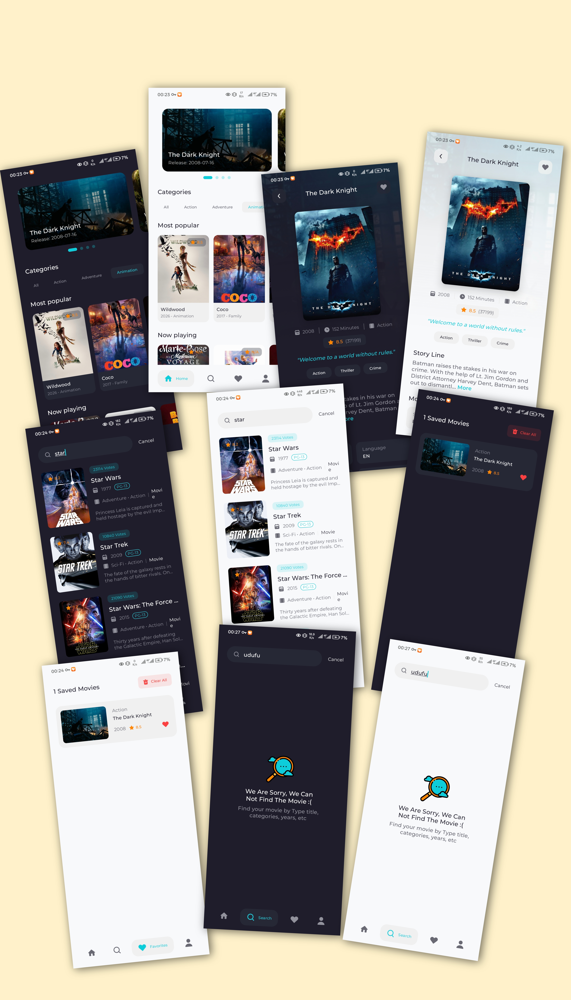

# Fimly

Fimly is a modern Android application designed for movie enthusiasts. It allows users to discover trending movies, search for specific titles, view in-depth details, and manage a personal offline-first favorites list. The app is powered by [The Movie Database (TMDB) API](https://www.themoviedb.org/).

## Screenshots


## Key Features

* **Dynamic Home Screen:** Browse movies by categories such as Most Popular, Top Rated, Now Playing, and Upcoming. Includes a dynamic genre filter.

* **Smart Search:** Search for movies with a seamless experience featuring a 500ms debounce to minimize unnecessary network calls, plus infinite scroll pagination.

* **Detailed Movie Info:** View high-quality posters, release dates, runtime, genres, storylines, and production companies.

* **Offline-First Favorites:** Add or remove movies to a personal favorites list. Saved movies and their cached images remain accessible even without an internet connection.

* **Robust State Management:** Comprehensive handling of all UI states including Shimmer loading effects, interactive empty states, and granular error states with dedicated "Retry" actions.

## Tech Stack & Libraries

Fimly is built entirely with modern Android development standards and technologies:

* **Language:** [Kotlin](https://kotlinlang.org/)

* **UI Toolkit:** [Jetpack Compose](https://developer.android.com/jetpack/compose)

* **Architecture:** Clean Architecture + **MVI** (Model-View-Intent)

* **Asynchronous Programming:** Coroutines & Flow

* **Networking:** [Ktor Client](https://ktor.io/docs/client.html)

* **Local Database:** [Room](https://developer.android.com/training/data-storage/room)

* **Local Preferences:** [DataStore](https://developer.android.com/topic/libraries/architecture/datastore)

* **Dependency Injection:** [Koin](https://insert-koin.io/)

* **Image Loading:** [Coil](https://coil-kt.github.io/coil/) (Configured with disk caching for offline support)

## Architecture & Technical Decisions

The application strictly follows **Clean Architecture** principles, separating concerns into `data`, `domain`, and `presentation` layers to ensure scalability and testability.

* **MVI Pattern & Granular State:** The UI layer utilizes the MVI pattern. Instead of a single monolithic state for complex screens (like Home), a reusable generic `ContentState<T>` wrapper is used. This allows individual sections (e.g., the Banner or Top Rated row) to fail and be retried independently without affecting the rest of the loaded screen.

* **Domain-Level Logic:** Logic such as mapping TMDB genre IDs to human-readable strings is encapsulated within the Domain layer. This prevents business logic from leaking into the UI components and keeps Composables stateless and reusable.

* **Lifecycle-Aware Collection:** UI states are collected using `collectAsStateWithLifecycle()` to ensure resources are safely released when the app goes into the background, preventing memory leaks and unnecessary processing.

## UI Design

The user interface is heavily inspired by the beautiful **Cinemax Movie Apps UI Kit**. You can view the original Figma template here: [Cinemax Figma Community File](https://www.figma.com/community/file/1088719884686291024/cinemax-movie-apps-ui-kit).

## How to Build and Run

To run this project, you will need a free API key from TMDB. **For security reasons, the API key is not included in this repository.**

**⚠️ Important Note for Users in Iran:** 
The TMDB API is restricted in Iran. You **must** have an active VPN connection on your device or emulator for the application to fetch data successfully.

1. **Clone the repository:**

   ```
   git clone https://github.com/yourusername/Fimly.git
   
   ```

2. **Get a TMDB API Key:**

   * Create an account at [themoviedb.org](https://www.themoviedb.org/).

   * Navigate to your account settings and generate an API key (v3 auth).

3. **Configure `local.properties`:**

   * Open the project in Android Studio.

   * Open (or create) the `local.properties` file in the root directory of the project.

   * Add the following line, replacing the placeholder with your actual API key:

   ```
   TMDB_BEARER_TOKEN="your_api_key_here"
   
   ```

4. **Build and Run:** Sync the project with Gradle files and run it on an emulator or physical device.

##  Known Limitations

* **Home Screen Pagination:** Currently, the categories on the Home screen (Popular, Top Rated, etc.) only load the first page of results. Infinite scroll pagination is currently only implemented within the Search screen.
